# Soham Kadam

**Computer Engineering Student · Aspiring Data Analyst**

*Turning curiosity into code, and data into insights.*

---

### About

I'm a third-year Computer Engineering student at VIT Pune, interested in understanding data, building useful software, and exploring intelligent systems.

- Currently learning **Data Analytics** with SQL, Excel and Power BI.
- Exploring **Python, AI/ML and software development**.
- Building projects that combine practical problem-solving with technology.
- Currently working on **Labelless AI**.

---

### Tech Stack

`SQL` · `Excel` · `Power BI` · `Data Analytics`

---

### GitHub Overview

### Contribution Activity

---

### Contribution Snake

<i>A little visual representation of my GitHub activity.</i>

<picture>
  <source media="(prefers-color-scheme: dark)" srcset="https://raw.githubusercontent.com/sohamkadamm/sohamkadamm/output/github-contribution-grid-snake-dark.svg">
  <source media="(prefers-color-scheme: light)" srcset="https://raw.githubusercontent.com/sohamkadamm/sohamkadamm/output/github-contribution-grid-snake.svg">
  
</picture>

---

### Let's connect

[LinkedIn](https://www.linkedin.com/in/soham--kadam/) · [Email](mailto:sohamkadam234@gmail.com)

*Learning continuously. Building thoughtfully.*

